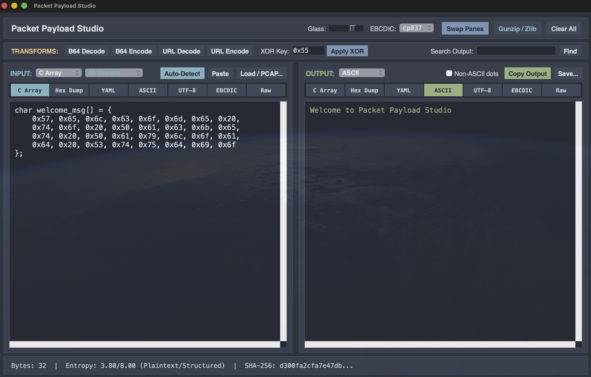

# Packet Payload Studio

A zero-dependency Python network payload analysis, packet stream reconstruction, and CyberChef-style transformation workbench built with Tkinter and the Nord palette.



## Features

- **Resizable 3-Pane Workbench:** Adjustable **Input**, collapsible **Transformation Pipeline**, and **Output** panes with **Nord Frost (Dark)** and **Nord Snow Storm (Light)** themes, a live **60–100% Window Transparency** slider (`Settings`), and persistent workspace preferences (`~/.packet_payload_studio.json`).
- **Hub-and-Spoke Format Converter:** Convert between **C Array** (with Wireshark `peer0` / `peer1` stream filtering, comment stripping, decimal/char/hex literals), **Hex Dump** (`hexdump -C`, `xxd`, and continuous hex), **YAML** (including Wireshark multi-line `!!binary |` blocks), **ASCII**, **UTF-8**, **EBCDIC (`cp037`)**, and **Raw** bytes.
- **CyberChef-Style Transformation Pipeline:** Chain, reorder, toggle (`On/Off`), inspect intermediate steps, step backward/forward (`<` / `>`) through recipe history, and save/load versioned `.json` recipes.
  - **Encodings & Web:** Base16, Base32, Base58, Base62, Base64 (Standard & URL-safe), ASCII85 (Base85), URL & Double-URL encoding/decoding (byte-exact for `0x80–0xFF`), HTML entities, Quoted-Printable, Unicode escape decoding, and JSON beautification.
  - **Compression & HTTP:** Auto-detection, **HTTP Extract Body** (headers + `Transfer-Encoding: chunked` + gzip/deflate), GZIP (including multi-member & truncated streams), ZLIB, Raw DEFLATE, BZIP2, and LZMA/XZ—all enforced with a **10 MB decompression-bomb ceiling**.
  - **Cryptography & Digests:** CRC32, Adler-32, MD5, SHA-1, SHA-256, SHA-384, SHA-512, SHA3-256, BLAKE2b, BLAKE2s, HMAC-SHA256/512, ROT13, and single/multi-byte XOR.
- **PCAP & PCAPNG Stream Reassembly:** Extracts directional IPv4/IPv6 (and 802.1Q/QinQ VLAN-tagged) TCP and UDP flows from Ethernet, Linux Cooked (`SLL`), and Loopback captures using magic-byte detection, ordering TCP segments by sequence number with wraparound handling and retransmission deduplication.
- **Protocol & Entropy Inspector:** Automatically detects HTTP/1.x, TLS records, GZIP/BZIP2/XZ/ZLIB streams, JSON, and common binary headers with length-normalized Shannon entropy diagnostics.
- **100% Local & Private:** All packet parsing, decompression, and transformations run locally offline with zero external network calls or third-party dependencies.

## Requirements

- **Python 3.9+** (tested on Python 3.11–3.13) with standard library `tkinter` enabled.

## Quick Start

```bash
git clone [https://github.com/Raulx7i/Packet-Payload-Studio.git](https://github.com/Raulx7i/Packet-Payload-Studio.git)
cd Packet-Payload-Studio
python3 main.py